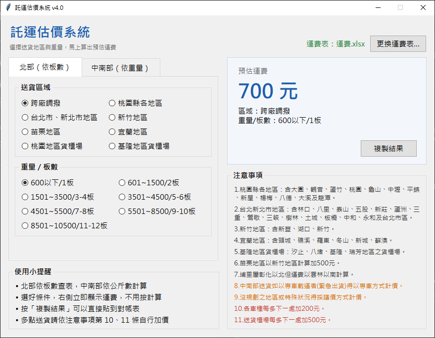

# 託運估價系統

讀取運費 Excel 表，選擇送貨區域和重量（或板數）後，馬上算出預估運費，協助公司核對託運廠商的請款金額。

> 為了公司對帳寫的小工具，重新優化的版本。



## 功能

- 開啟就自動讀取運費表，點選條件後**立即顯示運費**，不用按計算
- **北部（依板數）**：選擇送貨區域＋重量／板數，直接查表
- **中南部（依重量）**：選擇「彰化(含)以北」或「雲林(含)以南」，輸入公斤數，依重量級距計算
- 超過單車最大載重時，自動以兩台車計算
- 「複製結果」一鍵複製區域、重量與金額，方便貼到對帳表
- 右側顯示 Excel「注意事項」工作表的內容（加價規則、地區範圍等）
- 運費改在 Excel 調整，不用改程式；也可以隨時「更換運費表」

---

## 安裝

### 1. 事前準備

| 項目 | 說明 |
|---|---|
| **Python 3.9 以上** | 到 [python.org](https://www.python.org/downloads/) 下載，或安裝 [Anaconda](https://www.anaconda.com/download) |
| **運費 Excel 檔** | 專案已附 `運費.xlsx`，格式見下方「Excel 格式」 |

### 2. 下載專案

```
git clone https://github.com/tedchen05/freight-cost-estimator.git
cd freight-cost-estimator
```

### 3. 安裝套件

在專案資料夾開啟終端機，執行：

```
pip install -r requirements.txt
```

> 使用 Anaconda 的話，請在「Anaconda Prompt」中執行。

---

## 執行

### 方法一：終端機

在專案資料夾執行：

```
python freight_gui.py
```

### 方法二：VS Code 按 F5

1. 用 VS Code 開啟專案資料夾（第一次開啟時，右下角會建議安裝 Python 擴充功能，按「安裝」）
2. 按 `Ctrl + Shift + P`，輸入 `Python: Select Interpreter`，選擇**有安裝上述套件的 Python**
3. 按 **F5**

在「執行與偵錯」面板（`Ctrl + Shift + D`）上方可以切換：

| 選項 | 作用 |
|---|---|
| 執行託運估價系統 | 開啟估價視窗（預設） |
| 執行目前開啟的檔案 | 執行目前正在編輯的檔案 |

---

## 使用方式

1. 開啟程式，會自動讀取同一個資料夾的 `運費.xlsx`（右上角顯示目前的運費表）
2. 在左側選擇分頁：
   - **北部（依板數）**：點選送貨區域和重量／板數
   - **中南部（依重量）**：點選區域，輸入公斤數（只能輸入整數）
3. 右側「預估運費」會立即更新，按「**複製結果**」可以貼到對帳表，例如：
   `雲林(含)以南／12,000 KG（兩台車）：15,300 元`
4. 要用其他運費表時，按右上角「**更換運費表…**」選擇 Excel

> 一趟送兩個點以上時，程式不會自動加價，請依「注意事項」自行加算。

---

## Excel 格式

Excel 必須是 `.xlsx`，預設檔名 `運費.xlsx`，放在程式（或 exe）所在的資料夾，包含兩個工作表：

| 工作表 | 說明 |
|---|---|
| 第一個工作表（運費） | 第一列是送貨區域，第一欄是重量與板數；右側另有「中南區載運量」與「彰化(含)以北／雲林(含)以南」的級距費率 |
| `注意事項` | 一欄名為「注意事項」，每條以編號開頭（例如 `3.`），太長可以接續寫在下一列，會自動合併 |

- 可以修改運費數字和注意事項內容，但**不能變更工作表名稱**，也不要搬動欄位位置
- 修改前建議先備份，改完請確認金額正確

---

## 常見問題

**Q：右上角顯示「找不到 運費.xlsx」？**
確認 `運費.xlsx` 和程式（或 exe）放在同一個資料夾，或按「更換運費表…」自行選擇檔案。

**Q：跳出「Excel 格式不符」？**
確認 Excel 有「運費」與「注意事項」兩個工作表，且欄位位置沒有被搬動。

**Q：出現 `ModuleNotFoundError: No module named 'pandas'`？**
執行用的 Python 沒有安裝套件。照「方法二」重新選擇 Python，或對目前的 Python 執行 `pip install -r requirements.txt`。

**Q：出現 `Missing optional dependency 'openpyxl'`？**
pandas 讀取 `.xlsx` 需要 openpyxl，執行 `pip install -r requirements.txt` 即可。

**Q：重量欄打不進小數點或文字？**
重量只能輸入整數公斤數，其他字元會被擋掉。

**Q：顯示「無法計算」？**
重量超過兩台車的載重上限（目前是 17,999 KG），請拆單或直接跟託運廠商議價。

---

## 檔案說明

```
freight-cost-estimator/
├── freight_gui.py         # 視窗介面（主程式，執行這個）
├── freight_core.py        # 核心功能：讀取運費表、計算運費
├── requirements.txt       # 需要安裝的套件
├── 運費.xlsx              # 運費表（程式讀取的資料）
├── images/
│   └── screenshot.png     # 介面截圖
└── .vscode/
    ├── launch.json        # VS Code 按 F5 的執行設定
    └── extensions.json    # 建議安裝的 VS Code 擴充功能
```
